# Демо-проект по автоматизации тестирования MOBILE [WIKIPEDIA](https://github.com/wikimedia/apps-android-wikipedia/releases)

<p align="center">  
<a href="https://github.com/wikimedia/apps-android-wikipedia/releases"></a>  
</p>

## **Содержание:**

* <a href="#tools">Технологии и инструменты</a>

* <a href="#cases">Примеры автоматизированных тест-кейсов</a>

* <a href="#jenkins">Сборка в Jenkins</a>

* <a href="#console">Запуск из терминала</a>

* <a href="#browserstack">Интеграция с BrowserStack/a>

* <a href="#allure">Пример Allure отчета</a>

* <a href="#allure-testops">Интеграция с Allure TestOps</a>

* <a href="#video">Примеры видео выполнения тестов в BrowserStack</a>
____

<a id="tools"></a>
## <a name="Технологии и инструменты">Технологии и инструменты:</a>

<p align="center">  
<a href="https://www.jetbrains.com/idea/"></a>
<a href="https://www.java.com/"></a>  
<a href="https://github.com/"></a>  
<a href="https://junit.org/junit5/"></a>  
<a href="https://gradle.org/"></a>  
<a href="https://selenide.org/"></a>
<a href="https://github.com/allure-framework/allure2"></a> 
<a href="https://qameta.io/"></a>   
<a href="https://www.jenkins.io/"></a>
<a href="https://app-automate.browserstack.com/"></a>
</p>

- Тесты: IntelliJ IDEA + JUnit5 + Selenide
- Сборка: Gradle
- Среда: Android + BrowserStack
- Удаленный запуск: Jenkins
- Отчеты: Allure-отчет
---

<a id="cases"></a>
## <a name="Примеры автоматизированных тест-кейсов">Примеры автоматизированных тест-кейсов:</a>

- ✓ *Поиск статьи*
- ✓ *Просмотр статьи*
- ✓ *Добавление статьи в Сохраненные*
- ✓ *Удаление статьи из Сохраненных*

____
<a id="jenkins"></a>
## </a> <a name="Сборка"></a>Сборка в [Jenkins](https://jenkins.qa.guru/view/java_students/job/42_annap_wikimedia_mobile_tests/)</a>

<a id="console"></a>
### Команды для запуска из терминала

***Локальный запуск:***
```
bash gradle clean
```

***Удалённый запуск через Jenkins:***
```
bash  clean test
```

### Главная страница проекта в Jenkins

<p align="center">  
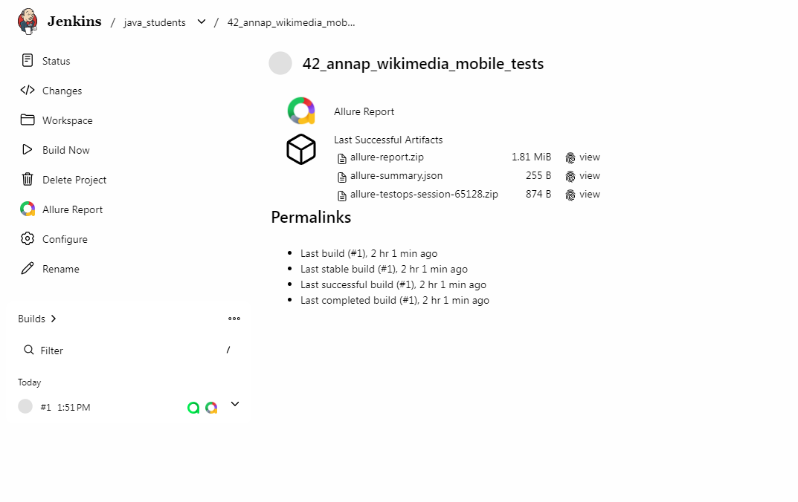  
</p>

___

<a id="browserstack"></a>
## </a> <a name="BrowserStack.png"></a>Интеграция с  [BrowserStack](https://app-automate.browserstack.com/overview)</a>

BrowserStack — это облачная платформа для тестирования веб-сайтов и мобильных приложений на реальных устройствах, браузерах и операционных системах.

### **Основные возможности:** 

- *Доступ к реальному парку устройств без покупки собственной фермы девайсов*
- *Ручное и автоматизированное тестирование*
- *Отладка и анализ*
- *Разота без установки: не нужно настроивать локальную инфраструктуру*

### *Сборки проектов*
Список всех своих запущенных сборок. В режиме реального времени можно отслеживать прогресс сборки.

<p align="center">  
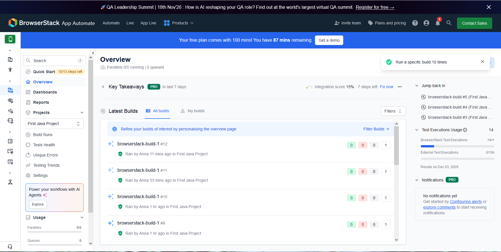  
</p> 

### *Общий обзор сборки*
Статистика по прохождению, сколько тестов запущено, информация по окружению, результаты сборки. 

<p align="center">  
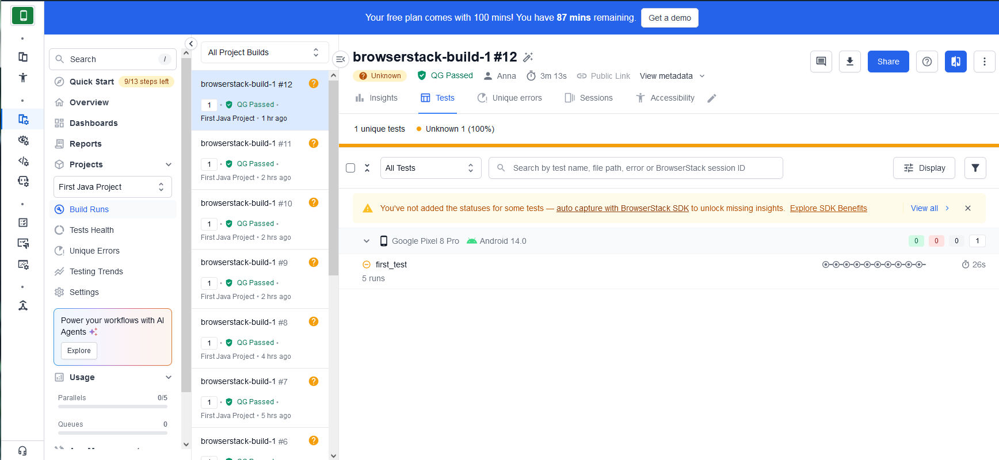  
</p> 

### *Подробная информация по результату прохождения теста*
Видеозапись, скрины страницы, pagesource страницы, общий обзор окружения.

<p align="center">  
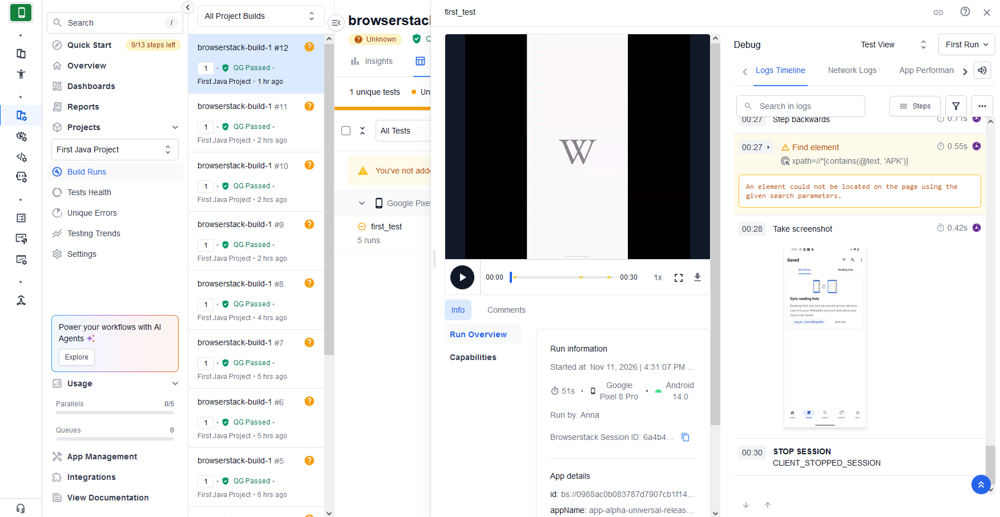  
</p> 

---

<a id="allure"></a>
## </a> <a name="Allure"></a>Allure [отчет](https://jenkins.qa.guru/view/java_students/job/42_annap_wikimedia_mobile_tests/1/allure/)</a>

Allure Report — это популярный инструмент с открытым исходным кодом от компании Qameta Software для визуализации результатов автоматизированного тестирования. Он преобразует «сухие» технические логи из автотестов в наглядные и интерактивные HTML-отчёты.

### **Что показывает Allure Report::**

- *Статусы и дерево тестов: сколько тестов прошло успешно (passed), сколько упало (failed) или сломалось (broken), сгруппированные по пакетам, фичам или уровням*
- *Детали шагов: пошаговый сценарий выполнения каждого теста*
- *Вложения (Attachments): скриншоты ошибок, сетевые логи, видеозаписи или JSON-ответы с сервера*
- *История запусков (Trends): графики изменения стабильности тестов от сборки к сборке (помогают выявлять плавающие или нестабильные тесты — flaky tests)*
- *Окружение (Environment): информация о версии ОС, браузере, стенде и параметрах запуска*


### *Основная страница отчёта*

<p align="center">  
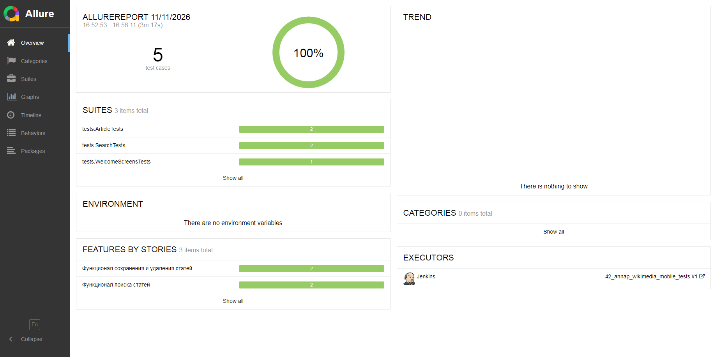  
</p>  

### *Тест-кейсы*

<p align="center">  
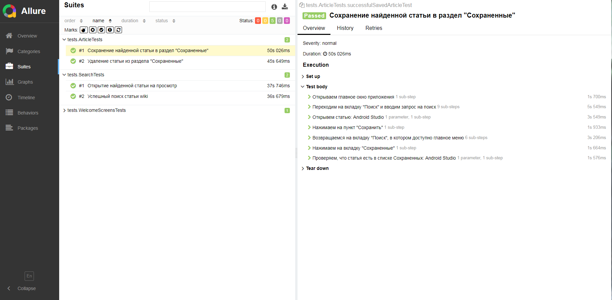  
</p>

Группировка по поведению:
<p align="center">  
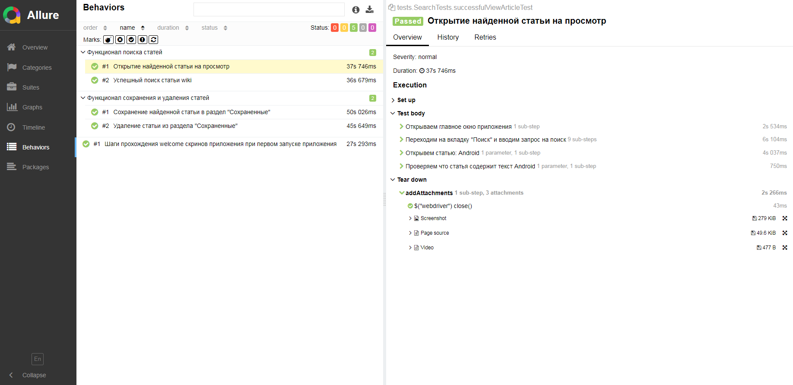  
</p>

### *Графики*

<p align="center">  
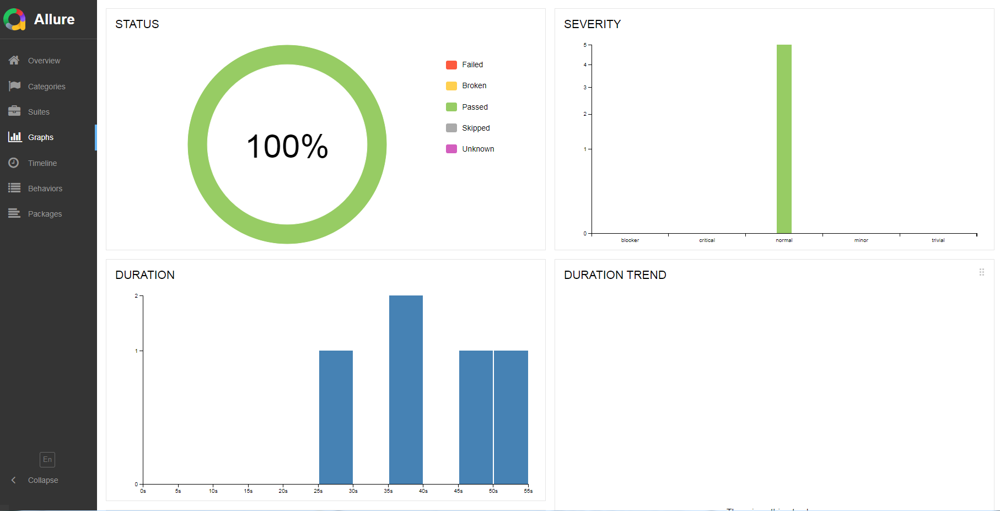  
</p>

___

<a id="allure-testops"></a>
## </a><a name="TestOps"></a>Интеграция с [TestOps](https://allure.qa.guru/project/5431/launches)</a>
TestOps Тестирование + Операции) — это методология и практика управления, автоматизации и масштабирования процессов тестирования в разработке ПО по аналогии с тем, как DevOps объединяет разработку и эксплуатацию.


### **Главные задачи и принципы TestOps:**

- *Интеграция в CI/CD: Встраивание тестов (ручных и автоматизированных) прямо в конвейеры сборки и доставки ПО*
- *Единое пространство: Объединение тест-кейсов, результатов прогонов, логов, дефектов и требований в одной системе (например, с помощью платформ вроде ТестОпс или Allure TestOps)*
- *Работа с автотестами: Масштабирование запуска тестов, управление тестовым окружением и сбор отчетов в реальном времени*
- *Аналитика и метрики: Поиск и устранение «нестабильных» (flaky) тестов, оценка покрытия и прозрачность релизов для бизнеса и разработчиков*
- *Сотрудничество: Тесная связь между QA-инженерами, разработчиками, DevOps-специалистами и менеджерами*


### *Запуски*

<p align="center">  
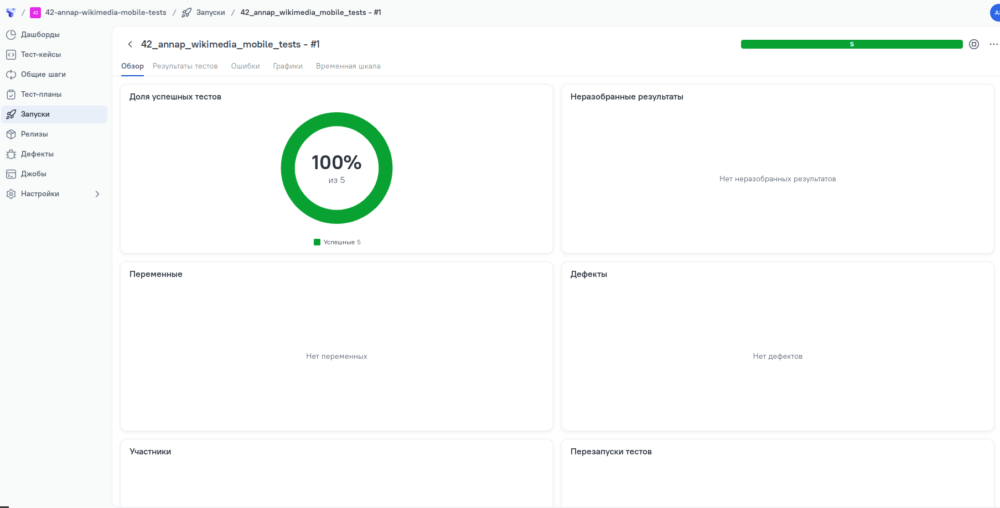  
</p>  


### *Авто тест-кейсы*

<p align="center">  
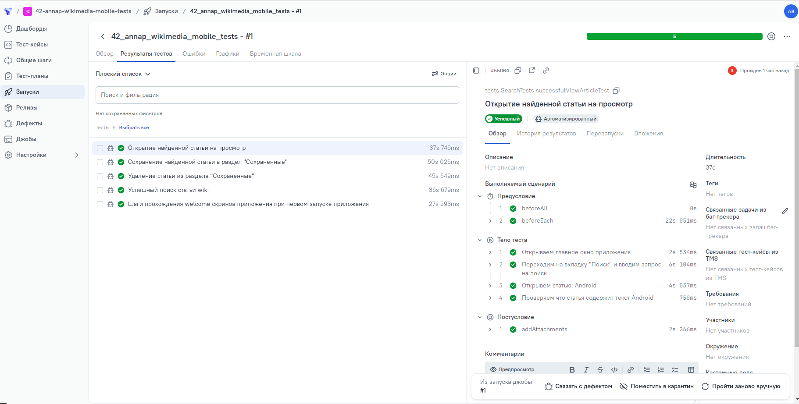  
</p>

____
<a id="video"></a>
## </a> Примеры видео выполнения тестов на BrowserStack

Каждый тест дополняется вложениями:
- Видео
- Ресурс страницы
- Последний скриншот
- Логи страницы

<p align="center">
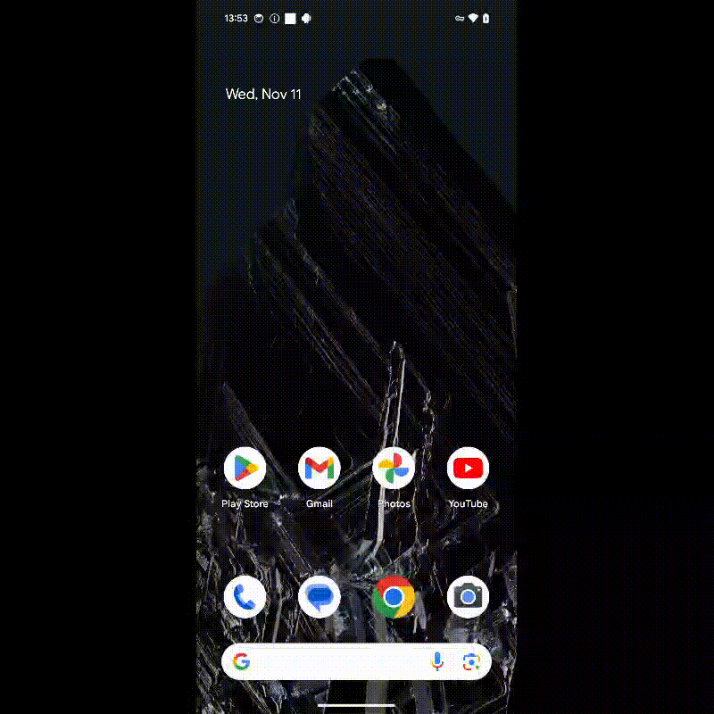   
</p>

